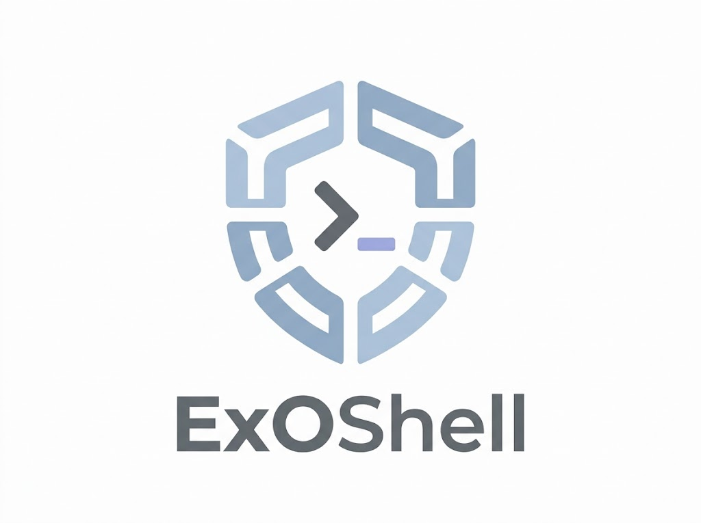

<!-- markdownlint-disable MD033 MD041 -->

<picture>
  <source media="(prefers-color-scheme: dark)" srcset="docs/brand/assets/ExOShell-dark.jpg">
  <source media="(prefers-color-scheme: light)" srcset="docs/brand/assets/ExOShell-light.jpg">
  
</picture>

<!-- markdownlint-enable MD033 MD041 -->

# ExOShell

Run Codex, Claude Code, or OpenCode against local projects in disposable
[NVIDIA OpenShell](https://docs.nvidia.com/openshell/) sandboxes with rootless Podman.
ExOShell provides the launcher, pinned tools image, provider profiles, and policies.

- Share only the project you choose, or opt into a larger source tree.
- Keep supported long-lived credentials behind provider-backed placeholders.
- Discard the sandbox and agent state on exit; keep mounted project edits.
- Extend images, policies, and integrations in a separate customization repository.

The baseline audits general network traffic and enforces provider endpoint
boundaries. Mounted project files remain writable by the agent.

**[Documentation](https://tojaj.github.io/ExOShell/)** ·
**[Get started](docs/get-started.md)** ·
**[Daily use](docs/guide/run-an-agent.md)**

## Prerequisites

A Linux gateway host with rootless Podman, Git, Python 3.11+, OpenShell 0.1.5+,
and an API key for your chosen inference backend. Follow the
[setup guide](docs/get-started.md) to configure the gateway, build images,
and create your first provider.

Once configured:

```bash
./run-exoshell-agent.sh /path/to/project
./run-exoshell-agent.sh --agent claude /path/to/project
./run-exoshell-agent.sh --agent opencode /path/to/project
```

## Explore

- [Integrations](docs/integrations/index.md): inference, forges, packages, and MCP.
- [Customize](docs/customize/index.md): images, policies, and private infrastructure.
- [Troubleshooting](docs/reference/troubleshooting.md) and [upgrade guide](docs/upgrade-openshell-0.1.5.md).
- [Architecture](ARCHITECTURE.md), [specification](SPEC.md), and [ADRs](adrs/).
- [Contributing and documentation preview](CONTRIBUTING.md).

Licensed under [Apache-2.0](LICENSE).
