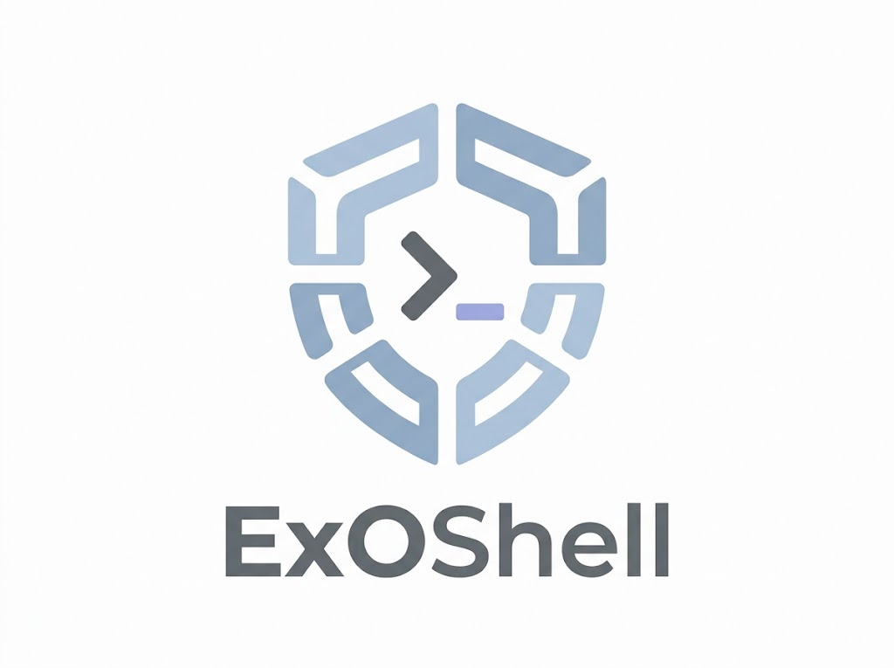
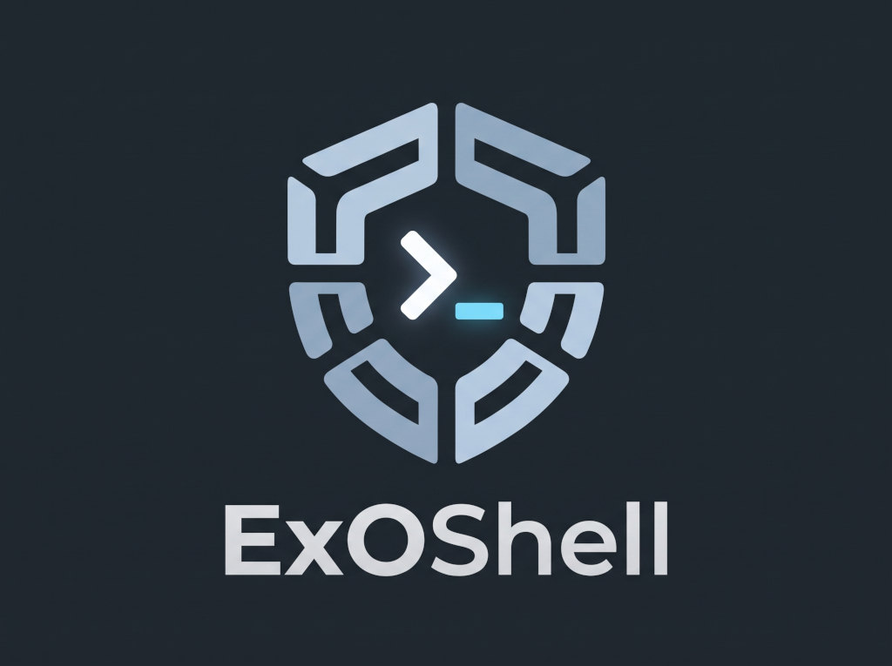

# ExOShell

{ .exoshell-brand .exoshell-brand--light }
{ .exoshell-brand .exoshell-brand--dark }

Run **Codex, Claude Code, or OpenCode** against your local projects in disposable
[NVIDIA OpenShell](https://docs.nvidia.com/openshell/) sandboxes.
ExOShell brings together the image, provider profiles, policies, and launcher
for everyday agent work with rootless Podman.

[Get started](get-started.md){ .md-button .md-button--primary }
[Explore integrations](integrations/index.md){ .md-button }

## A focused workspace for each session

- **Share the project you choose.** Mount one directory, opt into a larger
  source tree, or work in a disposable workspace with no host project mount.
- **Keep tools consistent.** Start with pinned coding agents and supporting
  CLIs already installed in the image.
- **Keep supported credentials outside the agent.** Providers supply
  placeholders; OpenShell resolves them only for permitted requests.
- **Start fresh.** The sandbox and agent runtime state are removed on exit.
  Changes to your mounted project remain on the host.

## Understand the boundaries

OpenShell provides isolation; ExOShell supplies a reusable setup. The sandbox
runs as a non-root user, and policies constrain filesystem and process access.
The portable baseline **audits general network traffic**; provider endpoints
**enforce** credential and request boundaries. It is not a blanket network deny
policy. See [policies](customize/policies.md) to tailor access.

An agent can modify the project you share. Credentials in an
[explicitly mounted kubeconfig](guide/workspaces.md#mount-a-kubeconfig) remain
readable, and interactive login flows can write readable credentials inside the
sandbox. Use the documented provider integrations and read
[sessions and credentials](guide/sessions.md) before adding services.

## Find your next step

| I want to… | Start here |
| --- | --- |
| Run my first session | [Get started](get-started.md) |
| Switch agents or set defaults | [Daily use](guide/run-an-agent.md) |
| Add GitHub, GitLab, packages, or MCP | [Integrations](integrations/index.md) |
| Use private infrastructure or extra tools | [Customize](customize/index.md) |
| Understand how it fits together | [Architecture](reference/architecture.md) |
| Diagnose a failed launch or request | [Troubleshooting](reference/troubleshooting.md) |
