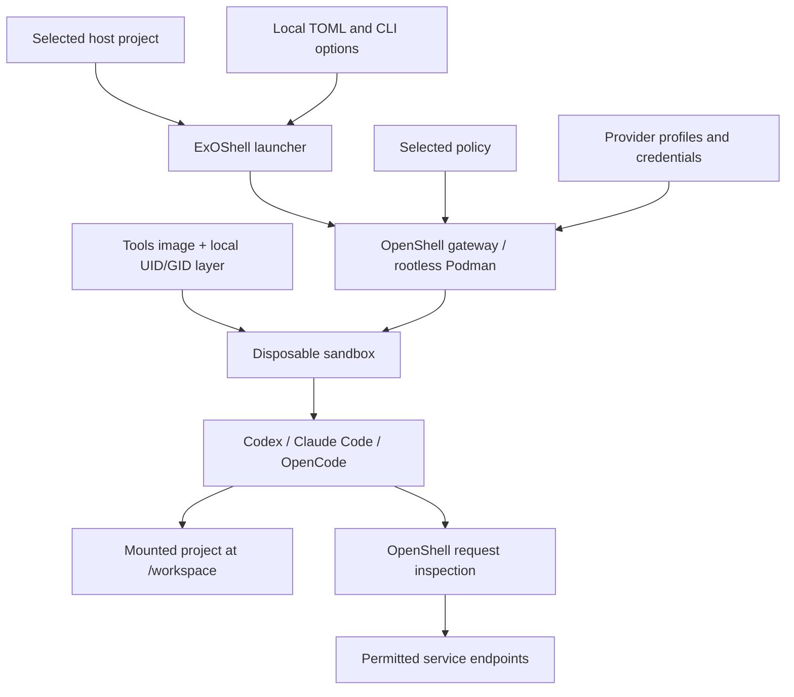

# Architecture

ExOShell assembles OpenShell's isolation, credentials, and policies into one
local development workflow.

## Images and identity

The base image extends the OpenShell community image with pinned agents and
supporting tools. A local layer maps the `sandbox` account to the host UID/GID
for writable rootless Podman mounts. Shared images contain no personal IDs or
credentials.

## Launch and lifetime

The launcher validates configuration, maps host paths below `/workspace`, and
creates a labeled sandbox. The image's `exoshell-agent` helper initializes
provider-backed integrations before starting the selected agent.

On normal exit, the sandbox and agent state are deleted. Files in the mounted
project remain. `--no-share` uses a disposable workspace; `--keep` retains the
container for debugging.

## Policies and providers

Policies control filesystem, process, and network access. Provider profiles
bind credentials to permitted endpoints and binaries. Instances hold local
credentials; agents receive placeholders. General baseline traffic is audited,
while provider endpoints enforce their request boundaries.

Host selection configures CLI/Git behavior; it does not create a provider or
grant access. Organization-specific profiles, policies, and images belong in a
[separate customization repository](../customize/index.md#separate-customization-repository).

For implementation details, read the
[architecture notes](https://github.com/Tojaj/ExOShell/blob/main/ARCHITECTURE.md),
[specification](https://github.com/Tojaj/ExOShell/blob/main/SPEC.md), and
[design decisions](https://github.com/Tojaj/ExOShell/tree/main/adrs).
